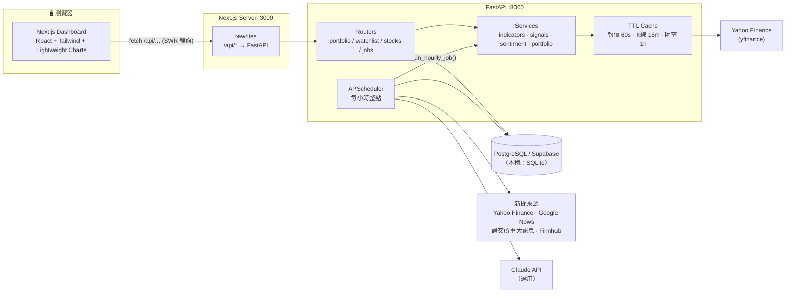
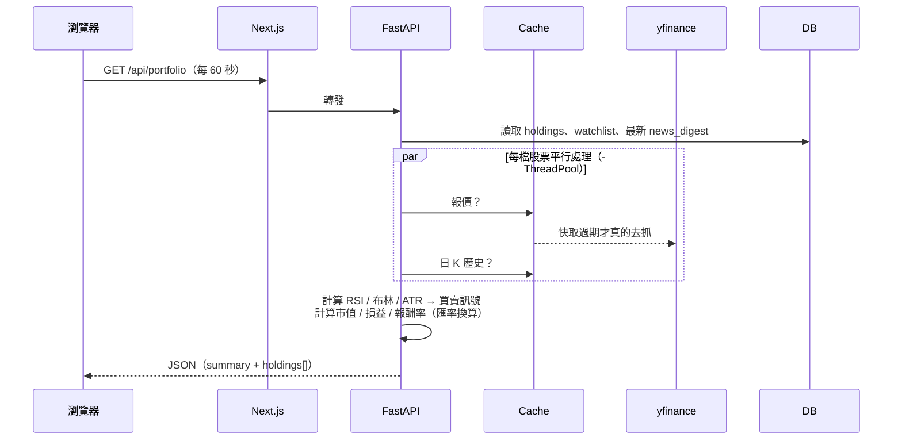
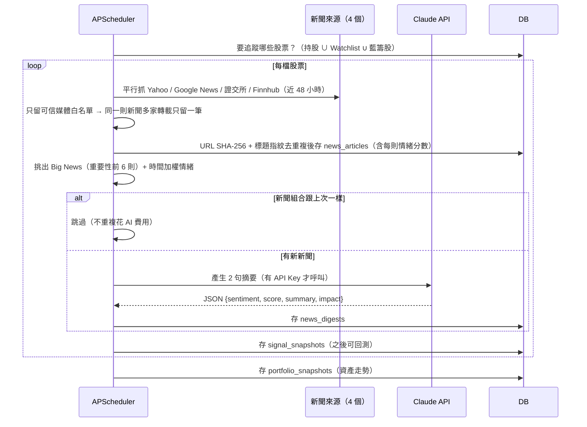
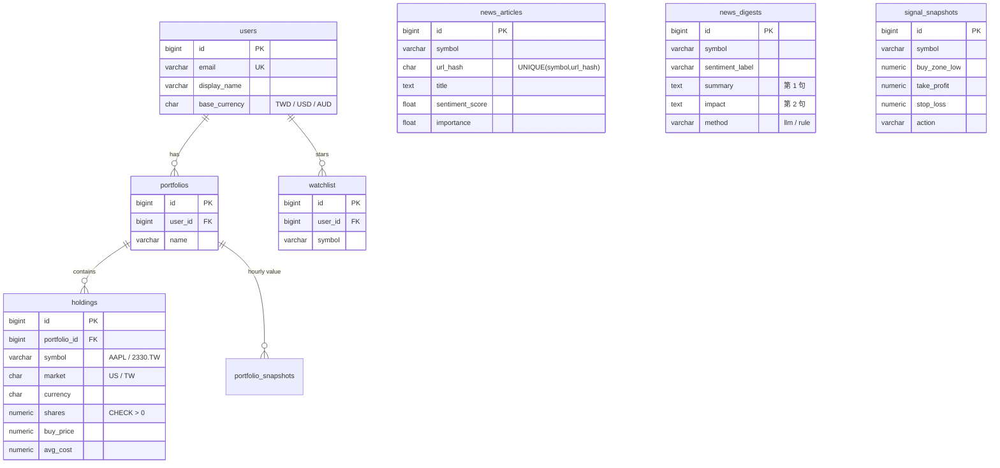

# 系統架構與資料流（System Architecture）

## 1. 整體架構

### 為什麼這樣分層？

| 層 | 負責 | 不負責 |
| --- | --- | --- |
| **前端（Next.js）** | 畫面、互動、定時輪詢（SWR） | 任何計算邏輯、API Key |
| **Next.js rewrites** | 把 `/api/*` 轉給後端 | — |
| **FastAPI Routers** | 驗證輸入、權限檢查、組合回應 | 計算細節 |
| **Services** | 純計算（指標、訊號、損益、情緒） | 知道 HTTP / 資料庫 |
| **Scheduler** | 每小時批次處理新聞與快照 | 回應使用者請求 |

> 💡 **把演算法放在 Python 後端**：pandas 計算方便、可以寫單元測試（`backend/tests/`），前端只負責「畫出來」。
> 前端換成 App、LINE Bot 也能重用同一套 API。

---

## 2. 兩條資料流

### A. 使用者開啟儀表板（即時，同步）

- **損益不存資料庫**：價格一直在變，所以每次查詢即時計算才正確（資料庫只存「股數、成本」這種事實）。
- **快取**：10 個人同時看台積電，Yahoo 只會被打 1 次。

### B. 每小時排程（背景，非同步）

排程的三種跑法（擇一）：

| 方式 | 適合 | 設定 |
| --- | --- | --- |
| 內建 APScheduler | 本機、單一伺服器 | `ENABLE_SCHEDULER=true`（預設） |
| 系統 crontab | VPS | `0 * * * * cd backend && .venv/bin/python -m app.jobs.hourly_news` |
| 外部 Cron 呼叫 API | Vercel / Render / 多 worker 部署 | `ENABLE_SCHEDULER=false`，排程服務呼叫 `POST /api/jobs/refresh-news`，Header 帶 `X-Cron-Secret` |

> ⚠️ 用 `uvicorn --workers 4` 時，每個 worker 都會各跑一份 APScheduler → 新聞會被重複抓 4 次。多 worker 請改用外部 Cron。

---

## 3. API 一覽

| Method | Path | 說明 |
| --- | --- | --- |
| GET | `/api/portfolio` | 投資組合總覽 + 每檔持股（報價、損益、訊號、情緒） |
| POST | `/api/holdings` | 新增持股 `{symbol, shares, buy_price, avg_cost?, note?}` |
| PATCH | `/api/holdings/{id}` | 修改持股 |
| DELETE | `/api/holdings/{id}` | 刪除持股 |
| GET | `/api/watchlist` | ⭐ 追蹤清單 |
| POST | `/api/watchlist` | 加入追蹤 `{symbol}`（重複加入也回成功＝冪等） |
| DELETE | `/api/watchlist/{symbol}` | 取消追蹤 |
| GET | `/api/stocks/{symbol}/chart?interval=1d\|1wk` | K 線 + MA/布林/RSI + 買賣標記 + 目前訊號 |
| GET | `/api/stocks/{symbol}/news` | AI 摘要 + 新聞列表（沒資料時現場抓一次） |
| GET | `/api/recommendations?market=ALL\|US\|TW` | 藍籌股推薦 + AI 評價 |
| POST | `/api/jobs/refresh-news` | 手動觸發排程（需 `X-Cron-Secret`） |
| GET | `/api/health` | 健康檢查 |

啟動後端後打開 <http://localhost:8000/docs> 可以直接在網頁上試打每一支 API（FastAPI 自動產生）。

---

## 4. 資料庫 Schema

完整 SQL：[`database/schema.sql`](../database/schema.sql)（已在 PostgreSQL 16 實測可執行）。

設計重點：

- **金額用 `NUMERIC`**，不用 `FLOAT`：浮點數會有 `0.1 + 0.2 = 0.30000000000000004` 的誤差。
- **`UNIQUE(portfolio_id, symbol)`**：同一個投資組合不會出現兩筆 AAPL（要加碼就編輯平均成本）。
- **`CHECK (shares > 0)`**：就算後端程式有 bug，資料庫也會擋下負數股數（縱深防禦）。
- **新聞以股票為單位共用**：100 個人都持有台積電，新聞只需要抓一份。
- **時間一律 `TIMESTAMPTZ`（UTC）**：台灣、澳洲、美國使用者看到的都是自己的當地時間。

---

## 5. 安全性設計（Security Notes）

| 風險 | 本專案的做法 | 檔案 |
| --- | --- | --- |
| 惡意輸入 / Injection | 股票代碼白名單 Regex；ORM 參數化查詢（不拼 SQL 字串） | `services/symbols.py` |
| IDOR（改網址 id 動到別人資料） | 查詢持股一定同時比對 `portfolio_id` | `routers/portfolio.py` |
| 排程 API 被濫用 | 未設定密鑰 → 404；比對用 `secrets.compare_digest` 防計時攻擊 | `routers/jobs.py` |
| 新聞雜訊 / 內容農場 | 只保留可信媒體白名單；網域比對加點號，避免 `evilreuters.com` 冒充 `reuters.com` | `services/news_sources.py` |
| API Key 外洩到 log | Finnhub Key 用 `X-Finnhub-Token` Header 傳送，不放在網址上 | `services/news.py` |
| XSS（新聞連結 `javascript:`） | 後端只收 http(s) 連結，前端再用 `safeExternalUrl` 檢查一次 | `services/news.py`、`lib/format.ts` |
| Reverse tabnabbing | 外部連結加 `rel="noopener noreferrer"` | `NewsPanel.tsx` |
| Prompt Injection（新聞標題要 AI 改答案） | 新聞放在 `<news>` 區塊並聲明是資料；Structured Output 固定格式；回傳值再驗證 / 夾住範圍 | `services/llm.py` |
| 機密外洩 | API Key 只放後端 `.env`（已加入 `.gitignore`），前端完全拿不到 | `config.py` |
| CORS | 只允許設定的前端網域，不用 `*` | `main.py` |

> 🔐 **目前是單人 Demo 模式**（`deps.py` 固定回傳 demo user）。要多人使用，請接上 Supabase Auth / NextAuth 並在 `get_current_user` 驗證 JWT——**永遠不要相信前端直接傳來的 user_id**。
